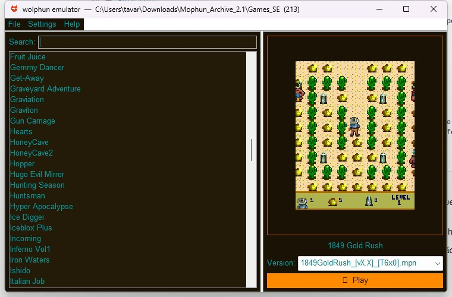
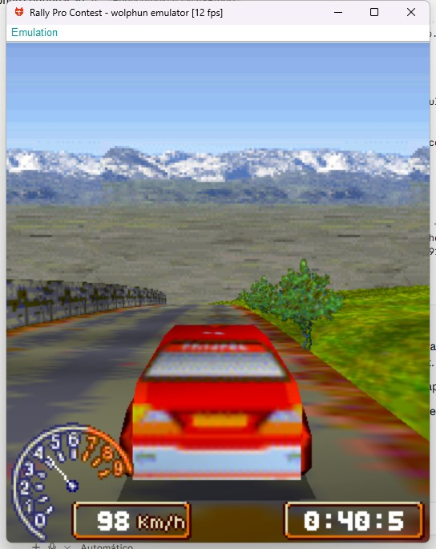
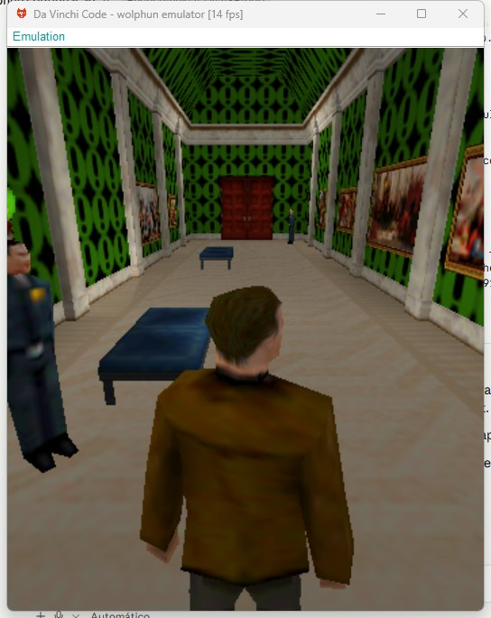
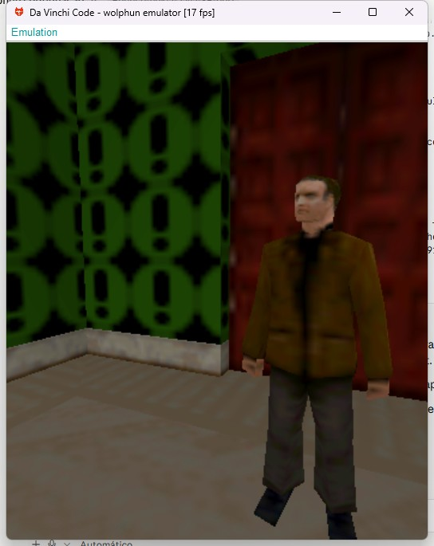
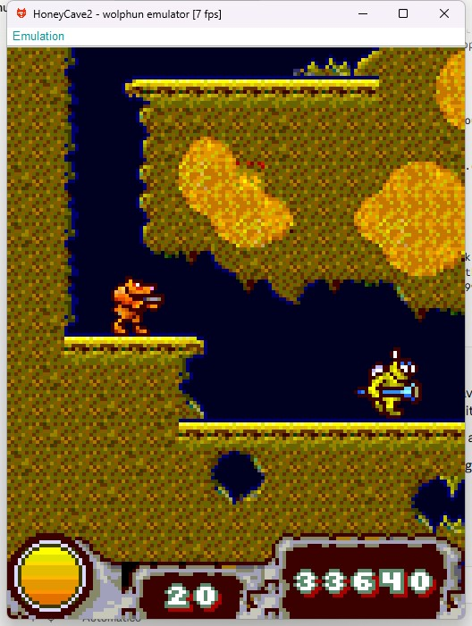
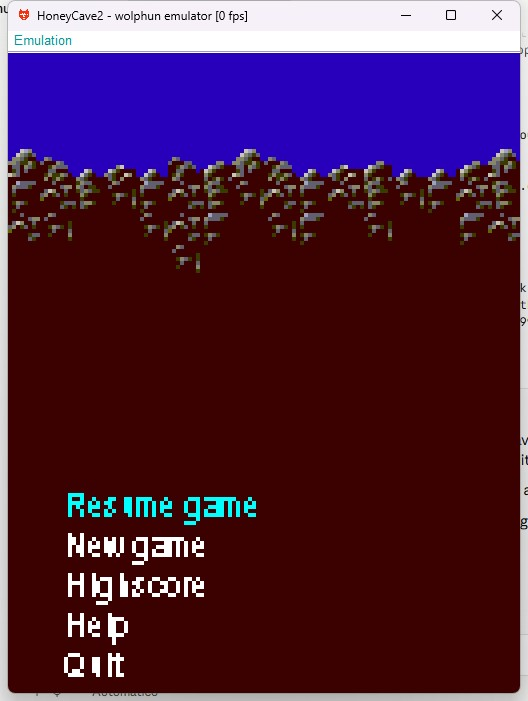

<p align="center">
  
</p>

<h1 align="center">wolphun — a Mophun emulator</h1>

<p align="center">
  An open-source emulator for <b>Mophun</b> games — the early-2000s mobile
  game platform (Synergenix / Sony Ericsson). Desktop, Android &amp; Symbian.
</p>

---

**wolphun** runs the original Mophun game bytecode on a from-scratch **PIP2 virtual
machine** with a software SDK layer, so menus, physics, collisions and enemies behave
exactly like on the real hardware — instead of re-implementing each game.

Three front-ends, one core:

- **Desktop** (Java SE) — GUI with a ROM library, save states, video/sound settings, and a one-click packaged `.exe`.
- **Android** (7.0+) — touch UI with an on-screen keypad you can **move and resize per game**, and a multi-language interface.
- **Symbian S60 3rd Edition** — a **native C++ port** that runs on the real Nokia hardware of the era (E63, E71, N95, N73, E61…). Ready-to-install `.sisx` packages included.

## Screenshots

<p align="center">
  
</p>

<table>
  <tr>
    <td align="center" width="33%"><br><sub><b>Rally Pro Contest</b> — software 3D</sub></td>
    <td align="center" width="33%"><br><sub><b>The Da Vinci Code</b> — textured interiors</sub></td>
    <td align="center" width="33%"><br><sub><b>The Da Vinci Code</b> — character detail</sub></td>
  </tr>
</table>

<table>
  <tr>
    <td align="center" width="50%"><br><sub><b>Honey Cave 2</b> — 2D tilemaps and sprites</sub></td>
    <td align="center" width="50%"><br><sub><b>Honey Cave 2</b> — title screen</sub></td>
  </tr>
</table>

> These are from the desktop build. The games run from their original, unmodified bytecode.

## What's new in 0.3.0-beta

### New platform: Symbian S60 3rd Edition

wolphun now runs **natively on the phones these games were sold for**. This is not the Java
core on a JVM — it is a **from-scratch C++98 port** of the PIP2 VM and the whole SDK layer,
with no STL and no libc in the emulation core, wrapped in a native **Avkon** UI that uses the
phone's own theme, menus and dialogs.

Two packages, because the Avkon DLL ordinals changed between OS releases and one binary
cannot cover both:

| Package | Symbian | Phones |
|---|---|---|
| `wolphun_fp1.sisx` | 9.2 and newer | E51, **E63**, E66, **E71**, E90, N81, N82, **N95**, and the 9.3 / 9.4 models (E72, E75, N85, N96, 5800, N97) |
| `wolphun_3rd.sisx` | 9.1 | E50, E60, E61, E61i, E62, E70, **N73**, N75, N80, N91, N92, N93 |

Both are **self-signed** — no developer certificate needed. Grab them from
[`symbian/bin/`](symbian/bin).

**Making 3D playable on a 2006 phone.** On S60 3rd there is no FPU: every `float` operation
is an `__aeabi_*` function call (a division costs around 200 cycles). The renderer was rebuilt
around that:

- **Exact per-scanline span bounds** from edge equations, instead of walking the triangle's
  bounding box — the old loop spent 68% of its iterations outside the triangle.
- **8-pixel perspective subdivision** — one reciprocal per span, affine interpolation in
  between. The span length matches the one found in the official Mophun VM for Symbian.
- **A fully fixed-point rasteriser** — 16.16 barycentrics and UVs, 10.22 depth, per-triangle
  scaling, no float left in the pixel loop.
- **Power-of-two texture wrap by mask** instead of a modulo per texel.

Verified frame-for-frame against the float renderer on all 19 3D ROMs in the test set.

**Also on Symbian:** MIDI music through the phone's own synthesizer plus a PCM stream for
sound effects, native file browser, save states, per-game settings, **interface in 6
languages** (English by default), **full-screen mode** with a configurable toggle key,
**vibration**, three screen-fit modes, and a **battery-safety CPU duty-cycle limit** — an
aged battery can brown out under a sustained 3D load, and the limiter caps how long the VM
runs inside each tick rather than just capping frames.

> The Symbian sources build with the S60 3rd Edition SDK — see
> [`symbian/LEIAME.txt`](symbian/LEIAME.txt). A Symbian 8.1 (EKA1) target for the N70 / N72 /
> N90 is present and complete in [`symbian/group2nd/`](symbian/group2nd), but is **not shipped
> as a binary**: the ARM compiler bundled with that 2005 SDK is a cygwin build that
> segfaults on modern Windows.

### Desktop

- **Screenshots** — `F12` captures the game, `Shift+F12` the whole window, saved as PNG.
- **Texture filter (3D)** — follow the game, force bilinear, or force nearest.
- **Keyboard presets** and **phone keys** — several games read the raw handset keys
  (Sony Ericsson 202–217) instead of the button bits; they are now mapped and remappable.
- **`vBeep` sound** — the games' simple tone channel now plays.
- **Theme readability** fixes, and **`F11`** to maximize the game window.

### Android

- **Vibration** — games that ask for it (Honey Cave 2 on damage) now vibrate, with an
  on/off switch in Settings.
- **On-screen keypad layouts** — auto, phone keypad, numbers, arrows, gamepad and mixed
  presets, on top of the existing per-game move & resize.
- **Per-ROM phone-key detection** — the loader statically analyses the game and shows only
  the handset keys it actually reads, so the keypad is not cluttered with dead buttons.
- **Screenshots** and **texture filter**, matching the desktop.
- **Bulk ROM import** and a clearer empty-library screen.

### Both GUIs

- The **About** dialog now shows a Ko-fi QR code and link, if you'd like to support the project.

## Features

- **Faithful PIP2 VM** — interprets the original game bytecode (116 opcodes); the game logic is the *real* one.
- **2D graphics** — sprites (multiple pixel formats), animated tilemaps, fills, lines, flat polygons, palette handling, transparency.
- **3D graphics** — a software rasterizer (matrix stack, z-buffer, perspective-correct textures, billboards, back-face culling) for the 3D racing / sports titles.
- **Sound** — MIDI and PCM/ADPCM playback, with optional **SoundFont (.sf2)** instrument banks on Android and a reverb toggle.
- **Themes** — customizable colors/fonts and ready-made themes (dark, light, retro, CRT, ocean, neon…) on the desktop and Android front-ends; the Symbian build uses the phone's own system theme.
- **Save states** — snapshot & restore any game (desktop **F5/F8**; Android and Symbian in-game menu).
- **Device profiles** — emulates different phone models & resolutions so games pass their terminal checks.
- **Desktop GUI** — ROM library with search + screenshots, per-game native saves, live key remapping, brightness/scale settings.
- **Android** — customizable on-screen controls (drag & pinch-to-resize, saved per game, à la J2ME-Loader / PPSSPP), a **6-language UI** (EN/ES/DE/PT/UK/RU), and shared-folder ROM support.
- **Symbian** — a native C++98 port for real S60 3rd Edition hardware: fixed-point software rasterizer, Avkon UI, the same 6-language interface, full-screen mode, vibration, and a battery-safety CPU limiter.

## Build & run

### Desktop (Java 8+)
```bat
cd desktop
build.bat        REM compiles to out\
run_emu.bat      REM opens the emulator (ROM library)
```
You can also package a **standalone `.exe`** with an embedded Java runtime:
```bat
package-exe.bat      REM uses jpackage (JDK 14+)
```
On Linux, `make-deb-linux.bat` builds a `.deb` (it needs only a JDK — no dpkg-deb, no WSL).

### Android (Android Studio)
Open the **`android/`** folder in Android Studio and press **Run**. `minSdk 24` (Android 7.0).
Add your `.mpn` files to the app's ROMs folder or `/sdcard/mophun`, or import them with the **“+”** button.

### Symbian S60 3rd Edition
No build needed to use it — copy the right package from [`symbian/bin/`](symbian/bin) to the
phone and open it:

- **`wolphun_fp1.sisx`** — Symbian 9.2 and newer (E63, E71, N95, 5800, N97…)
- **`wolphun_3rd.sisx`** — Symbian 9.1 (N73, N80, E61, E70…)

They are self-signed, so the phone may ask you to allow software from untrusted sources
(*Tools → App. manager → Options → Settings → Software installation: All*).
Put your `.mpn` files anywhere and register the folder in *Options → Game folders*.

To build it yourself you need the S60 3rd Edition SDK; the whole procedure, including the
traps, is written up in [`symbian/LEIAME.txt`](symbian/LEIAME.txt):
```bat
cd symbian\group
build.cmd fp1          REM Symbian 9.2+     (build.cmd 3rd for 9.1)
..\sis\makesis.cmd fp1 REM signs and packages
```

>  You provide your own game files — **this project does not include any game ROMs.**

## Repository layout
```
desktop/    Java SE version   (PIP2 VM + software SDK + Swing GUI)
android/    Android version   (same VM core + SurfaceView + touch UI)
symbian/    Symbian S60 port  (C++98 VM + software SDK + Avkon UI)
   bin/     ready-to-install .sisx packages
   src/vm/  the portable core: no STL, no libc, no Symbian API
   group/   build for Symbian 9.1 / 9.2+   group2nd/  build for Symbian 8.1
```
The Java emulation core (`wolphun.vm.*`) is shared between the desktop and Android
front-ends; only the platform layer (display, audio, input) differs. The Symbian port is
an independent C++ implementation of the same VM and SDK semantics.

## Credits & references

wolphun was written by studying open-source Mophun preservation projects. Huge thanks to:

- **[nofun](https://github.com/RadratSoftworks/nofun)** by *RadratSoftworks* — the C# Mophun emulator used as the **authoritative reference** for SDK / VMGP behaviour (graphics, input, sound, device caps, and the 3D pipeline). A large part of wolphun's SDK layer follows nofun's semantics.
- **[MoRePhun](https://github.com/Luca1991/MoRePhun)** — reference for the PIP2 opcodes.
- **[TinySoundFont & TinyMidiLoader](https://github.com/schellingb/TinySoundFont)** by *Bernhard Schelling* — bundled in `android/app/src/main/cpp/` to power the Android SoundFont (.sf2) playback. `tsf.h` is MIT, `tml.h` is zlib; both keep their own licence, reproduced in the files and listed in [NOTICE](NOTICE).

wolphun is an **independent reimplementation** (Java on desktop and Android, C++ on
Symbian) — no code was copied from the projects above; they were used to understand the
platform's behaviour.

## Support the project

wolphun is free and open source. If it brought a game back for you, you can buy me a coffee:

[](https://ko-fi.com/M7U128G86G)

The same link (and a QR code for it) is in **Help → About** inside the emulator, on desktop and Android.

## License

Released under the **Apache License 2.0** — see [LICENSE](LICENSE) and [NOTICE](NOTICE).

You may use, modify and redistribute it, including in closed-source and commercial work,
as long as you keep the copyright and licence notices and state what you changed. The
licence also grants an explicit patent licence from the contributors.

Bundled third-party files keep their own licences; see [NOTICE](NOTICE).

---

<p align="center">Made by <b>Jamisson Tavares</b> · Maned Software 🐺</p>
